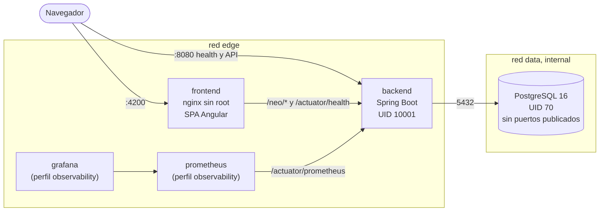
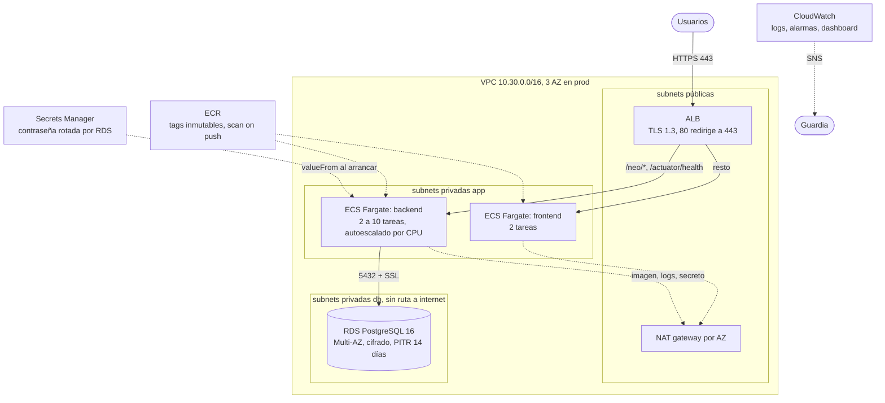
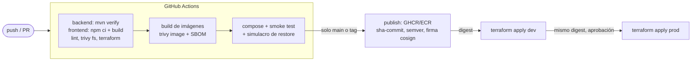

# Arquitectura y decisiones

## Local (docker compose)

- `edge`: lo que se publica en el host. `data`: red `internal`, sin salida; solo backend y PostgreSQL.
- Los tres servicios con `read_only`, `cap_drop: ALL`, `no-new-privileges`, límites de CPU y memoria, rotación de logs y health checks. Arrancan en orden por salud: base, backend, frontend.
- Un solo comando: `docker compose up --build`. Funciona sin `.env`.

## AWS (propuesta en Terraform)

| Componente | Decisión |
| --- | --- |
| Cómputo | ECS Fargate. Sin servidores que parchar y sin la complejidad de EKS para dos contenedores. |
| Base de datos | RDS PostgreSQL 16. Backups, PITR, Multi-AZ y parches administrados. |
| Entrada | ALB en subnets públicas; es lo único expuesto. Rutea por path: `/neo/*` y `/actuator/health` al backend, el resto al frontend. |
| Red | Tres capas por AZ. La base no tiene ruta a internet. Security groups encadenados por referencia, sin rangos de IP. |
| Secretos | La contraseña la genera y rota RDS en Secrets Manager; ECS la inyecta al arrancar. Terraform solo conoce el ARN. |
| Imágenes | ECR con tags inmutables, escaneo al subir y limpieza automática. |
| Estado de Terraform | S3 con `use_lockfile` (sin DynamoDB), una llave por ambiente. Idealmente una cuenta por ambiente. |
| Ambientes | `infra/environments/dev` y `prod` usan los mismos módulos; cambian solo sus `terraform.tfvars`. |

### Separación de ambientes

| | Dev | Prod |
| --- | --- | --- |
| Zonas de disponibilidad | 2 | 3 |
| NAT | 1 compartido | 1 por AZ |
| Backend | 1 a 2 tareas, Fargate Spot | 2 a 10 tareas, Fargate normal |
| RDS | `db.t4g.micro`, una AZ, backups 7 días | `db.m7g.large`, Multi-AZ, backups 14 días, deletion protection, snapshot final |
| HTTPS | opcional | obligatorio (el plan falla sin certificado) |
| Logs | 14 días | 30 días |

### Alta disponibilidad y escalamiento

- Prod reparte tareas y NAT en 3 AZ; si cae una, las otras siguen sirviendo y RDS hace failover a su réplica en 1 a 2 minutos.
- El backend escala por CPU (objetivo 60%) entre 2 y 10 tareas. El frontend es estático y 2 tareas alcanzan.
- El límite real de escala es PostgreSQL: cada tarea abre hasta `DB_POOL_MAX_SIZE` conexiones. Una validación de Terraform impide que `tareas máximas x pool` pase del 80% de `max_connections`. Para escalar más allá, el siguiente paso es RDS Proxy.
- Despliegues con rolling update (100% mínimo, 200% máximo) y circuit breaker con rollback automático.

## Flujo de entrega

Detalle en `docs/ci-cd.md`.

## Decisiones

| Decisión | Alternativa descartada | Por qué |
| --- | --- | --- |
| Runtime del backend: Temurin JRE 17 sobre Ubuntu 24.04 LTS | `eclipse-temurin:17-jre-alpine`, Liberica JRE sobre Alpaquita | La de Temurin alpine solo existe para amd64; quien evalúe en una Mac con Apple Silicon tendría que emular. Liberica es multi arquitectura y mucho más chica (la usé primero), pero Trivy no reconoce su sistema operativo y el gate no habría visto los paquetes del SO. Noble es multi arquitectura, mismo proveedor que el build y sale sin HIGH/CRITICAL. Preferí poder escanearla a ahorrar megas. |
| Jar separado en capas de Spring Boot | Copiar el jar completo | Dependencias y aplicación van en capas distintas: cada deploy mueve ~250 kB en vez de 53 MB y el build reutiliza caché. |
| Healthcheck con `wget` que ya trae la imagen | curl | Se quita curl de las dos imágenes y no se instala nada extra. |
| nginx resuelve el backend en cada petición (`resolver` + variable) | `proxy_pass http://backend:8080` fijo | Con el fijo, nginx guarda la IP al arrancar: si el backend se reinicia y cambia de IP hay 502 hasta reiniciar nginx, y nginx ni siquiera arranca si el backend no existe todavía. |
| Compose con valores por defecto de solo local | Variables obligatorias (`:?`) | La guía de evaluación corre `docker compose up` sin crear `.env`. La base no publica puertos, así que el valor por defecto no es alcanzable desde fuera. |
| Trivy desde su imagen, fijada por digest | `aquasecurity/trivy-action` | Misma herramienta en local y CI, una action de terceros menos. |
| Gate de CVE en CRITICAL con parche | Bloquear también HIGH | Hoy hay 15 HIGH en Angular 18 y 15 en librerías de Spring que solo se arreglan cambiando de versión mayor o menor del framework, fuera del alcance. El reporte HIGH queda visible y el plan es bloquear HIGH después de actualizar. |
| Solo `tomcat.version` a 10.1.60 | Subir Spring Boot a 3.5 | Arregla los 7 CRITICAL sin tocar la aplicación. Subir el framework es el siguiente paso, en su propia rama. |
| Flyway con `ddl-auto: validate` | Seguir con `ddl-auto: update` | Cambios de esquema versionados, revisables y reproducibles en una restauración. |
| Deploy con `terraform apply` y digest | Registrar task definitions desde el pipeline | Una sola fuente de verdad; Terraform no revierte lo que desplegó el pipeline. |
| Plan de Terraform sin cuenta (`offline_plan`) | Pedir credenciales para revisar | La guía corre `init -backend=false`, `validate` y `plan`. Sin data sources que llamen a la API, el plan sale completo con llaves falsas. |
| us-east-1 | mx-central-1 (México) | Todos los servicios y precios más bajos. Si la latencia desde México importa, mx-central-1 es una opción directa: solo cambian región y AZ en los tfvars. |

## Supuestos

- Hay una cuenta de AWS por ambiente (o al menos roles separados) y el pipeline asume un rol por OIDC.
- Existe un dominio y un certificado en ACM para prod.
- El volumen es bajo (un estacionamiento): los tamaños de instancia son un punto de partida, se ajustan con métricas reales.
- El equipo acepta Angular 18 y Spring Boot 3.3 temporalmente, con plan de actualización.

## Limitaciones conocidas

- La infraestructura no se aplicó en una cuenta real: está validada con `terraform validate`, `plan` offline y Trivy, pero los tiempos de AWS del documento de recuperación son estimados.
- El job de despliegue a AWS está documentado, no implementado (no hay cuenta).
- El proyecto no trae pruebas de frontend; la validación es el build AOT estricto y `npm audit`.
- La API no tiene autenticación (riesgo 8 en `docs/security.md`).
- Trazas distribuidas: propuesta, no implementadas (`docs/observability.md`).
- `verify.sh` y `verify-local-stack.sh` necesitan Java y Maven instalados; yo validé con `verify-docker.sh` y con el pipeline, que corren las mismas pruebas y el mismo build.

## Costo aproximado (us-east-1, precios de lista)

| Componente | Dev (USD/mes) | Prod (USD/mes) | Nota |
| --- | ---: | ---: | --- |
| RDS PostgreSQL | ~15 | ~250 | En prod es el mayor costo: Multi-AZ duplica la instancia. |
| NAT gateway | ~35 | ~100 | Uno por AZ en prod, más tráfico procesado. |
| ALB | ~20 | ~25 | Más LCU según tráfico. |
| Fargate | ~10 (Spot) | ~90 | 2 tareas de backend 1 vCPU/2 GB y 2 de frontend 0.25/0.5. |
| CloudWatch (logs, Container Insights, alarmas) | ~10 | ~30 | |
| ECR, KMS, Secrets Manager, S3 | ~5 | ~10 | |
| **Total aproximado** | **~95** | **~505** | |

Dónde ahorrar si hace falta: Savings Plans o instancias reservadas para RDS y Fargate (30 a 40%), endpoints de VPC para ECR y CloudWatch para bajar el tráfico por NAT, y Fargate en ARM64 (Graviton, ~20% más barato; las imágenes base ya son multi arquitectura, solo falta construir también para arm64 en el pipeline).
